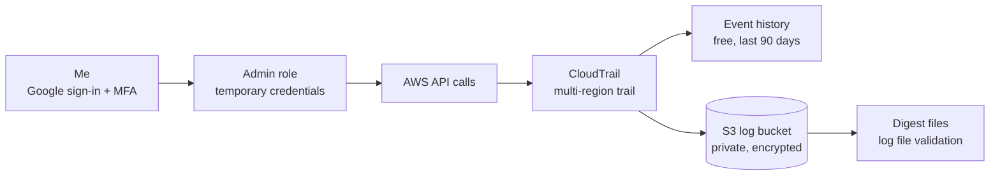

# AWS Account Security Starter

A new AWS account set up with protected sign-in and permanent audit logging, then tested by creating and deleting a resource and tracing both actions in the logs.

Built by hand in the AWS Console (no code) as the first project in my move into AWS cloud security.

## Why this matters

A default AWS account has no permanent audit trail. If something goes wrong, nobody can answer who did what, when, and from where. This project sets up the basics every account should have on day one: strong sign-in, a record of every action, and proof that the record is trustworthy.

## Architecture

## What I set up

| Control | What it does |
| --- | --- |
| MFA on my AWS Builder ID | A one-time code from an authenticator app protects sign-in, plus a recovery email |
| Role-based access | I work through a role with temporary credentials (up to 12 hours). There are no IAM users with permanent keys |
| CloudTrail trail | `management-events-trail` records all management events (read and write) in every region |
| Private S3 log bucket | Holds the log files. Public access blocked, default encryption on |
| Log file validation | Creates signed digest files so tampering with logs can be detected |
| Cost safety | Free plan plus a $5 monthly budget alert |

Region used: `ap-southeast-2` (Sydney).

## How I tested it

1. Created an S3 bucket in the console.
2. Deleted it about 12 minutes later.
3. Found both events (`CreateBucket`, `DeleteBucket`) in CloudTrail Event history and read the event records.

| Question | What the log showed |
| --- | --- |
| Who | Assumed role `AccountFullAccessRole` |
| What | `CreateBucket`, then `DeleteBucket`, for my test bucket |
| When | Timestamps in UTC, matching my local time |
| From where | My own public IP address |
| With what | Chrome on a Mac, so a human using the console |
| MFA flag on the session | `false`. I tested sign-in separately and MFA was required, so this field does not show the MFA I used |

I also compared this with an event AWS created by itself during sign-up (default network creation). That one shows an AWS service as the caller, no IP address, and `eventType: AwsServiceEvent`.

## Screenshots

Account IDs, emails and IP addresses are blurred.

- `docs/screenshots/trail-created.png`: the trail in Logging state
- `docs/screenshots/log-bucket.png`: log files and digest folder in S3
- `docs/screenshots/create-bucket-event.png`: the `CreateBucket` event record
- `docs/screenshots/delete-bucket-event.png`: the `DeleteBucket` event record

## What I learned

- Newer AWS accounts can use role-based access from the start, with no IAM users and no long-term keys.
- `AdministratorAccess` allows everything. That is fine for learning but is the opposite of least privilege.
- Event history is free but covers 90 days and one region at a time. A trail keeps logs permanently.
- I tested MFA instead of assuming it worked. Signing out of only the console session did not ask for a code, but signing out of AWS fully and signing in again did. MFA is enforced at a fresh Builder ID sign-in, and CloudTrail's `mfaAuthenticated` field did not reflect it.
- On a shared or work machine, use the full "Sign out of AWS", not just the console sign-out.
- Filtering Event history by `Read-only = false` quickly shows only the actions that changed something.

## Limitations and next steps

- Single account, with no AWS Organizations or service control policies
- Logs are stored but not yet analyzed or alerted on
- No threat detection yet
- Next: S3 security hardening, then automatic alerts and remediation with narrow least-privilege roles
- GuardDuty is not available on my account type, so I studied it as a concept instead of using it

## Cleanup

The test bucket is already deleted. The trail and its log bucket are kept running on purpose. To remove them, delete the trail in CloudTrail, then empty and delete the log bucket in S3.

## Docs

- `docs/notes.pdf`: short notes with diagrams explaining the concepts used here
